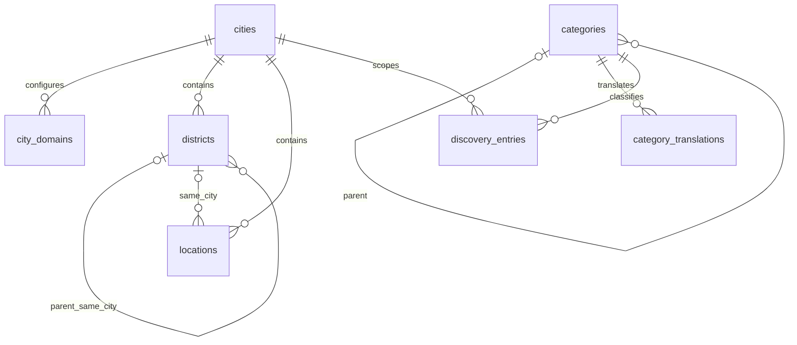

> **Current status (HA-002-R01, 19 November 2026):** The owner-authorized remediation in [Issue #10](https://github.com/Shiva721254/HappyAlmere/issues/10) is a review candidate on feature/ha-002-a. Earlier pending-design statements below are historical and superseded by the [current implementation report](../reports/HA-002-implementation-report.md). Existing applied migrations and original database remain preserved. No independent acceptance, merge or deployment is implied. HA-002-ARCH-01 remains unavailable as a standalone verified source.

# Implemented catalog relationships - HA-002-A

Review candidate; owner authorized implementation in Issue #4 comment 7014717337.
The original integer/public migration is preserved; CatalogForward appends these
relations. No Identity, business, live hostname resolver or customer records.

UUID PKs; category_translations uses (category_id, language_code). District alternate
key (city_id,id) supports composite FKs from child districts and locations. Serialized
hierarchy writes reject cycles; higher isolation levels are explicitly rejected for
hierarchy writes rather than relying on stale snapshots. Runtime is read-only.

Discovery retains the original district display string; no inferred relationship to
districts. Domain/district/location tables start empty. City domains are configuration
only: no host activation or city resolver is implemented. See the [dictionary](data-dictionary.md)
and [migration policy](migration-policy.md) for preservation/default semantics.
