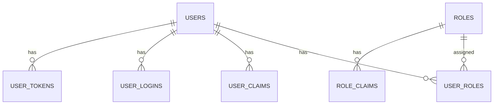

# HA-003-A Identity persistence foundation

## HA-003-A-ARCH-R01 - current remediation (20 November 2026)

This section supersedes prior candidate-status statements below; historical evidence remains historical. Owner decisions D01-D08 and bounded G05-G09 authority are recorded in [Issue #34](https://github.com/Shiva721254/HappyAlmere/issues/34#issuecomment-7025018945). The owner-approved post-download evidence clarification and successful G05 preflight are recorded in [comment 7035023769](https://github.com/Shiva721254/HappyAlmere/issues/34#issuecomment-7035023769).

Branch `feature/ha-003-a`, draft PR #32; exact start `c5b61a362fd35522718401e558961e12d1b24bab`, accepted base `216df25c5656a979fcf67dfe3a16d07d7d66f154`. Exactly thirteen existing paths are authorized; no new tracked files, migrations, dependencies or workflow edits. No merge, public authentication, production data or next milestone. Claude independently reviews G10; G11 owner acceptance and G12 merge authority remain separate.

### R01 runtime and independent verification contract

The per-open interceptor implements RTA-01-16 in one read-only PostgreSQL command with a five-second command timeout, cancellation and no cache. Both authenticated and effective role must be happy_identity_app, client VerifyFull and actual TLS must hold, dangerous role attributes/memberships/ownership are rejected. It checks DML on all seven tables, no extra table/column privileges or grant options, no history permissions, USAGE-only claim sequences, schema and database limits, and protected catalog/discovery isolation. False/error/cancellation closes the connection; failed close falls back to disposal. Diagnostics omit server/connection details. Disabled registration remains unchanged and adds no command.

Column ACL fallback uses `acldefault('c', owner)`, not a generic empty array: PostgreSQL requires one-dimensional ACL arrays. This corrects the SQLSTATE 22023 inventory failure without dropping column checks. See [PostgreSQL privilege functions](https://www.postgresql.org/docs/18/functions-info.html) and [check_acl implementation](https://github.com/postgres/postgres/blob/REL_18_STABLE/src/backend/utils/adt/acl.c).

ACL-01-20 are independently verified across identity/catalog/discovery/public. The expected reference uses immutable accepted historical definitions plus independently written literal Identity SQL and explicit approved grants; expected rights are never learned from a migrated/restored target. Inventories include role attributes, direct and transitive MEMBER/USAGE/SET/admin authority, raw grantor/grantee ACLs, effective table/column/sequence/database/schema/routine rights and grantability, owners, implicit PUBLIC defaults via acldefault, all relevant owners' defaults, routine signatures/definitions/security-definer/search-path configuration, retired restore authority and private probes. Actual clean/upgrade/recovered/restored inventories must match; mutation cleanup must restore exact inventory, including provenance.

Parameterized deviations run only on task-owned synthetic PostgreSQL: authenticated VerifyFull positive, one intended deviation, exact mismatch/runtime result or SQLSTATE, finally cleanup, positive and exact complete authority equality. Existing 42501/28000/23505/23503/23502/23514/P0001 checks remain. Sixteen provider lifecycle/configuration tests are locally passed; actual PostgreSQL cases remain pending CI. Benchmark workloads use five warmups and forty measured sync/async pooled samples, separating open, authority query and open+authority+read; report p50/p95/p99/max, errors/timeouts and command counts. p95 must be <=25 ms; no threshold relaxation or production-capacity claim.

Existing CI evidence.json holds reference/matrix/mutation summaries and runtime metrics. After CI completes, download and preserve each original ZIP. Run `python scripts/verify-identity-foundation.py --inspect-archive <original.zip> --inspection-evidence <separate-working-copy/evidence.json>`; record actual run/head/archive identity in Issue #34/PR #32. The command checks every JSON payload and PNG structure/CRC/decompression, rejects unknown files and embedded PNG text, and records per-entry hashes. Rendered screenshots require separate visual review. This post-download record is explicitly separate from the original CI evidence; patterns are not exhaustive secret certification.


Implementation candidate on `feature/ha-003-a`, exact baseline `216df25c5656a979fcf67dfe3a16d07d7d66f154`. This is persistence-only development using isolated synthetic data, not public authentication or production acceptance.

## Authority and preflight

- [Assignment #26](https://github.com/Shiva721254/HappyAlmere/issues/26), [approved compatibility contract #28](https://github.com/Shiva721254/HappyAlmere/issues/28), [IAM-G04 authorization](https://github.com/Shiva721254/HappyAlmere/issues/28#issuecomment-7023159754).
- [INT-G12](https://github.com/Shiva721254/HappyAlmere/issues/27#issuecomment-7022990043) passed; exact baseline tree `b2dcbcaeaad73fbfa6c57260ccb8654f00164893`, parents `719dbcc6f0d05f9d2f338f74b89cec8991a3aa6f` and `dfb62229f85d8b490b287d4cf0ddf3f36b96a9ad`.
- [IAM-G05 preflight evidence](https://github.com/Shiva721254/HappyAlmere/issues/28#issuecomment-7023218886): pinned Identity EF 10.0.14, EF Core 10.0.14 and Npgsql EF 10.0.3 restored and compiled in Debug/Release with zero warnings/errors before substantive changes; transitive audit reported no known vulnerabilities. SDK 10.0.403. No package-source or unrelated dependency changes.
- Owner remains accountable migration coordinator. No competing migration stream identified at preflight. The 34-path maximum is authoritative; older historical execution restrictions in preserved documents are superseded only by this bounded owner authorization.

## Implementation boundaries

Infrastructure owns framework entities, explicit EF mapping, dedicated context/factory/stores and registration. Domain/Application and existing discovery context/migrations remain unchanged. Web only composes the optional service. `IdentityFoundation:Enabled` defaults false; enabled configuration requires the dedicated `happy_identity_app` connection, VerifyFull TLS, no session overrides, and actual server role/SSL/authority verification on connection. No startup migration, cookie scheme, SignInManager, route scaffolding, token provider, permanent account/role seed or customer data.

New users/roles receive framework-compatible UUIDv4; user names are opaque `Id.ToString("N")`. Framework normalization and hashing remain authoritative. Unique normalized names/emails are database enforced. Future password/session/MFA policies from #12 are not represented as implemented framework defaults.

## Physical contract provenance

The following dictionary is reproduced from independently supplied Issue #26 and approved by #28/IAM-G04. Its original “proposed” wording describes source provenance; it does not imply authorization for later phases. The independent executable reference is [verify-identity-contract.sql](../../scripts/verify-identity-contract.sql). The generated migration is `20261119215427_InitialIdentity`; separate snapshot and history are confined to IdentityMigrations/identity. UUID version/variant, nonnegative failed count and nonempty normalized identifiers are explicit checks. All required indexes are named in the independent SQL and actual metadata evidence.

## 4. Proposed physical database contract
Shared PostgreSQL database; preserve catalog/discovery; introduce identity only. No speculative business/commerce/audit/sessions/preferences/city memberships tables. Exactly seven functional identity tables plus one technical migration history. Explicit snake_case mapping for functional tables; framework-compatible history convention. Physical mapping and account policy require owner approval and compatibility verification. PK=primary key; FK=foreign key; NN=not null; NULL=nullable.

### 4.1 identity.users
| Column | PostgreSQL type | Nullability / constraint |
|---|---|---|
| id | uuid | NN PK, UUIDv4 |
| user_name | varchar(256) | NN |
| normalized_user_name | varchar(256) | NN unique |
| email | varchar(256) | NN |
| normalized_email | varchar(256) | NN unique |
| email_confirmed | boolean | NN |
| password_hash | text | NULL |
| security_stamp | text | NN |
| concurrency_stamp | text | NN |
| phone_number | text | NULL |
| phone_number_confirmed | boolean | NN |
| two_factor_enabled | boolean | NN |
| lockout_end | timestamp with time zone | NULL |
| lockout_enabled | boolean | NN |
| access_failed_count | integer | NN |
One globally unique normalized email and internal username, framework normalizer, no provider-specific alias rewriting; enforce physical uniqueness, concurrent creations. Proposed future email login with opaque internal unique username not public display identity, generation convention to approve. Nullable password_hash permits approved future alternative credentials, no external login exposure in A. Optional framework phone field not justification to collect real phone data. Security/concurrency stamps initialized consistently, framework hashing and concurrency. No permanent privileged/test seed.

### 4.2 identity.roles
| Column | Type | Constraint |
|---|---|---|
| id | uuid | NN PK UUIDv4 |
| name | varchar(256) | NN |
| normalized_name | varchar(256) | NN unique |
| concurrency_stamp | text | NN |
No permanent administrator role assignment or privileged bootstrap account.

### 4.3 identity.user_roles
| Column | Type | Constraint |
|---|---|---|
| user_id | uuid | NN FK identity.users.id |
| role_id | uuid | NN FK identity.roles.id |
Composite PK (user_id, role_id), many-to-many users/roles. Global role names do not grant private resource authority.

### 4.4 identity.user_claims
| Column | Type | Constraint |
|---|---|---|
| id | integer | NN identity-generated PK |
| user_id | uuid | NN FK identity.users.id |
| claim_type | text | NULL |
| claim_value | text | NULL |

### 4.5 identity.role_claims
| Column | Type | Constraint |
|---|---|---|
| id | integer | NN identity-generated PK |
| role_id | uuid | NN FK identity.roles.id |
| claim_type | text | NULL |
| claim_value | text | NULL |
Claims use provider-compatible integer identity generation and do not bypass future resource policies.

### 4.6 identity.user_logins
| Column | Type | Constraint |
|---|---|---|
| login_provider | varchar(128) | NN composite PK |
| provider_key | varchar(128) | NN composite PK |
| provider_display_name | text | NULL |
| user_id | uuid | NN FK identity.users.id |
Composite PK (login_provider, provider_key); framework storage only, no external provider integration.

### 4.7 identity.user_tokens
| Column | Type | Constraint |
|---|---|---|
| user_id | uuid | NN composite PK/FK identity.users.id |
| login_provider | varchar(128) | NN composite PK |
| name | varchar(128) | NN composite PK |
| value | text | NULL |
Composite PK (user_id, login_provider, name); not general plaintext secret vault; future token/authenticator secret protection separately reviewed; no live/reusable OAuth refresh tokens.

### 4.8 identity.__EFMigrationsHistory (technical)
| Column | Type | Constraint |
|---|---|---|
| MigrationId | varchar(150) | NN PK |
| ProductVersion | varchar(32) | NN |
Provider-supported convention, separate context history, provision schema/ownership before provider creates history; verify actual bootstrap behavior. No runtime schema creation.

### 4.9 ERD, cardinalities and indexes

All six required FK relationships 1:N; proposed cascade only framework-owned dependents, no future financial/business/audit cascade or unrestricted account-deletion functionality. Technical history not related to accounts.
| Table | Secondary index | Type |
|---|---|---|
| users | normalized_user_name | unique |
| users | normalized_email | unique |
| roles | normalized_name | unique |
| user_roles | role_id | nonunique B-tree |
| user_claims | user_id | nonunique B-tree |
| role_claims | role_id | nonunique B-tree |
| user_logins | user_id | nonunique B-tree |
PKs already supply uniqueness indexes. No redundant index. Document actual constraint/index names and all types/lengths/nullability/defaults/identity generation/delete behavior; compare EF model to actual PG and independently specified expected contract. No speculative cross-context FKs; later references use authoritative UUID, explicit cross-context transaction/retention rules; contexts not automatically same transaction.


## Roles, recovery and evidence boundaries

| Principal | Approved authority |
|---|---|
| happy_identity_owner | NOLOGIN, owns identity only; no database CREATE/TEMP |
| happy_identity_migrator | Login, CONNECT, controlled membership/SET ROLE identity owner; no catalog/discovery authority |
| happy_identity_app | Explicit SELECT/INSERT/UPDATE/DELETE on seven tables; USAGE on two claim sequences; no history/DDL/grant options |
| happy_identity_backup | SELECT on seven tables/history and two sequences; no catalog/discovery access or writes |
| happy_identity_restore | Temporary isolated restoration only; membership and CONNECT revoked, NOLOGIN afterward; real TLS authentication and authorization denials required |

Existing happy_app/happy_backup/happy_schema_migrator receive no Identity rights. No broad future-table grants. Full effective table/column/sequence/schema/database privileges, PUBLIC ACLs, role flags/memberships/admin/grant options are checked. Distinct runtime connections limit accidental authority, not compromise of the shared process.

The runner creates task-specific containers, volumes, random credentials and loopback ports using the pinned existing PostgreSQL image. It never connects to a preserved source DB. An accepted catalog is created from immutable migrations, privately backed up and restored before Identity changes. The literal independent SQL contract is compared against clean/upgrade/recovery physical metadata. Controlled P0001 is injected after schema/history work before COMMIT; complete rollback, independent fresh recovery/reapply and complete no-op are required. Independent clean catalog creation timestamps may differ; each path's complete pre/post catalog state is preserved exactly, and canonical business rows plus full Identity state are compared.

Post-change backups use separate restricted catalog and Identity roles under synthetic quiescence, with complete shared-state checks before/between/after. Restoration reconciles data, both histories, metadata, sequences and ACLs. Pre-existing public/identity schema creation entries are excluded from restore TOCs because these schemas are already provisioned; object ownership/privileges are checked afterward. No authority expansion is used to make restore pass.

Only sanitized `artifacts/identity/<run>/evidence.json` may be uploaded. Environment files, archives, generated SQL, raw snapshots, hashes/tokens and diagnostic logs stay in protected ignored directories. Runtime children receive an explicit environment allowlist; test/migration/backup/restore credentials are excluded. The original database recovery script remains byte-for-byte unchanged.

## Repeatable verification

From the repository root with the approved SDK, Node and local Docker available:

```powershell
dotnet restore HappyAlmere.slnx
dotnet tool restore
dotnet build HappyAlmere.slnx -c Debug --no-restore
dotnet build HappyAlmere.slnx -c Release --no-restore
python scripts/verify-identity-foundation.py
$testEnvironment = Get-ChildItem artifacts/identity/*/tests.env | Sort-Object FullName | Select-Object -Last 1
./scripts/Test-Local.ps1 -EnvironmentFile $testEnvironment.FullName
. ./scripts/Load-LocalEnvironment.ps1 -EnvironmentFile $testEnvironment.FullName
npm ci --ignore-scripts
npm run browser:install
npm run test:browser
dotnet list HappyAlmere.slnx package --vulnerable --include-transitive
npm audit --audit-level=high
python scripts/verify-source.py
```

Keep HTTPS trust configured using the existing development runbook; never disable certificate validation. For manual enabled-mode debugging, explicitly select the protected run's `runtime.env` with `Start-Local.ps1`; do not use `tests.env` as a debugger configuration or modify the original .env.runtime/debugger contract. Context-qualified EF commands use `--context HappyCityDbContext` or `--context HappyCityIdentityDbContext`, and `--configuration Release`. Migration credentials are never supplied to the web process.

## Verification status and handoff

Local candidate verification: Debug and Release builds pass with zero warnings/errors; 157 enabled .NET tests and all 105 original tests with Identity disabled pass with zero failures/skips. The isolated runner passes eleven checks. Trusted HTTPS browser verification passes 42 responsive cases, 190 functional/security assertions and five rate assertions; all three suites verify loopback-only listeners and reject six non-loopback attempts each. NuGet/npm audits report no known vulnerabilities. Implementation head d4ec551 passed both push/PR CI; [HANDOVER](../../HANDOVER.md#verified-implementation-ci-and-review-handoff) records actual jobs, checkouts, artifact IDs/digests and numeric results. Final documentation-head results are linked in the GitHub submission ledger. Independent review remains outstanding. [ACCEPTANCE](../../ACCEPTANCE.md) owns criterion dispositions; [HANDOVER](../../HANDOVER.md) owns final commit/PR/CI synchronization. No historical results are substituted for fresh candidate evidence. Independent HA-003-A-ARCH-01 review, exact-candidate owner acceptance and separate merge authority remain mandatory.

## Remaining limitations

No live authentication, sessions, resource authorization, MFA, email/recovery, native issuer, business memberships or commerce. DEF-01–08 remain tracked. Production key management, protected backups/retention/encryption/RPO/RTO, sensitive token storage and account lifecycle controls remain later review gates. Synthetic quiescent restoration is not a production-consistency guarantee. STRATO-first hosting and deferred business verification/code signing remain unchanged.


## Local verification ledger and diagnostic history

The exact approved changed-file inventory (first sixteen additions, remaining eighteen modifications):

```text
HappyAlmere_V0.1_MVC/src/HappyCity.Infrastructure/Identity/ApplicationUser.cs
HappyAlmere_V0.1_MVC/src/HappyCity.Infrastructure/Identity/ApplicationRole.cs
HappyAlmere_V0.1_MVC/src/HappyCity.Infrastructure/Identity/HappyCityIdentityDbContext.cs
HappyAlmere_V0.1_MVC/src/HappyCity.Infrastructure/Identity/HappyCityIdentityDbContextFactory.cs
HappyAlmere_V0.1_MVC/src/HappyCity.Infrastructure/Identity/IdentityConfiguration.cs
HappyAlmere_V0.1_MVC/src/HappyCity.Infrastructure/Identity/IdentityServiceRegistration.cs
HappyAlmere_V0.1_MVC/src/HappyCity.Infrastructure/IdentityMigrations/20261119215427_InitialIdentity.cs
HappyAlmere_V0.1_MVC/src/HappyCity.Infrastructure/IdentityMigrations/20261119215427_InitialIdentity.Designer.cs
HappyAlmere_V0.1_MVC/src/HappyCity.Infrastructure/IdentityMigrations/HappyCityIdentityDbContextModelSnapshot.cs
HappyAlmere_V0.1_MVC/tests/HappyCity.FoundationTests/IdentityPersistenceTests.cs
HappyAlmere_V0.1_MVC/tests/HappyCity.FoundationTests/IdentityPrivilegeTests.cs
HappyAlmere_V0.1_MVC/tests/HappyCity.FoundationTests/IdentityArchitectureTests.cs
HappyAlmere_V0.1_MVC/tests/HappyCity.FoundationTests/IdentityMigrationTests.cs
scripts/verify-identity-foundation.py
scripts/verify-identity-contract.sql
docs/database/identity-foundation.md
HappyAlmere_V0.1_MVC/src/HappyCity.Infrastructure/HappyCity.Infrastructure.csproj
HappyAlmere_V0.1_MVC/src/HappyCity.Web/Program.cs
HappyAlmere_V0.1_MVC/src/HappyCity.Web/appsettings.json
scripts/Initialize-LocalDatabase.ps1
scripts/verify-forward-migration.py
scripts/Start-Local.ps1
scripts/run-browser-tests.cjs
.github/workflows/build.yml
README.md
CHANGELOG.md
HANDOVER.md
PROJECT_STATUS.md
TASKS.md
DECISIONS.md
ACCEPTANCE.md
docs/README.md
docs/DEVELOPMENT.md
docs/security/security-risk-register.md
```

- Successful runner: `artifacts/identity/iam-20261119221337-1e544b/evidence.json`; protected archives/configuration are deliberately untracked. Final CI reruns the committed runner and publishes only sanitized evidence.
- Enabled test run: 157 passed, zero failed/skipped; disabled original suite: 105 passed, zero failed/skipped. Original tests and the 250ms thresholds remain unchanged.
- Enabled 10,000-distinct-row traversal p95: 23.2062ms (local sequential synthetic workload, not production capacity). Actual EF query p95 values are retained in `artifacts/forward-tests/r01-query-plans.json`; CI supplies independently attributable fresh values.
- Initial rehearsal failures were diagnostic harness defects: exhausted Docker default subnet pool (empty prior task network reused without deletion); EF CLI short option ambiguity (explicit `--configuration` used); existing public schema in restore TOC; independent catalog timestamps; libpq connection-error SQLSTATE omission. None was converted into a passing negative test.
- Initial architecture test used unavailable Windows `pwsh`; it now uses installed Windows PowerShell and Linux `pwsh`. Initial full runs had 154 passes/two failed TLS positive controls under migration execution roles; `SET ROLE NONE` verifies the authenticated login before restoring the owner role. Corrected complete reruns pass. No production privileges or certificate controls were weakened.
- Preserved source verifier passed reachable-history/current-source scan (31 commits, 5,299 historical file versions, zero findings at that invocation). The subsequent full scan also passed; both implementation CI source scans passed with actual counts in HANDOVER. This pattern scan is not a guarantee of secret absence.
- Scope review: exactly 34 approved paths, 16 additions/18 modifications; protected migrations, old context, original tests and original recovery/source verifiers unchanged. No merge/deploy/settings changes.
